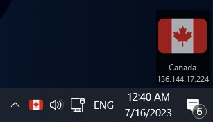
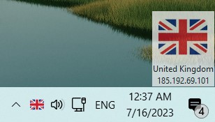

# My IP Info Widget

Created by Mostafa Mandegari (مصطفی ماندگاری).

See your public IP address, country, city and internet provider in real time —
on the desktop and in the system tray (Windows).




## Features (v0.3.0)

- Country flag, IP address, and (optionally) city and provider
- Lives in the tray: nothing sits on the desktop. Click the tray icon and a small pop-up
  appears next to the taskbar; it closes when you click elsewhere
- Live download / upload speed in the pop-up and in the tray tooltip
  (with a VPN the traffic is counted once, not twice)
- Weather (temperature and a symbol) for a city you choose yourself: right-click, "Choose city
  for weather..." and search by name (Persian or English); data from Open-Meteo
- Today's downloaded / uploaded volume (counted while the program runs, resets at midnight)
- Speed, volume and weather can each be switched off from the right-click menu
- A globe with a red slash shows when there is no internet
- Right-click the pop-up for a menu: copy IP, refresh, opacity, keep on desktop, start with Windows, quit
- "Keep on desktop" brings back the always-visible, draggable widget
- Double-click the widget to copy the IP address
- Remembers its position and settings
- Follows the Windows dark / light theme
- Uses encrypted (https) lookups with automatic fallbacks, and only asks for
  location details when your IP actually changes
- Shows "No Internet" only after two failed checks, so short hiccups don't flicker
- Only one copy can run at a time

## Install

Download `Mostafa-MultiWidget-Setup.exe` from the Releases page (or from the *Actions* tab →
latest run → *Artifacts*) and run it. No administrator rights needed.

Settings and a small log file live in `%APPDATA%\MyIPWidget`.

## Run from source

```
pip install -r requirements.txt
python main.py
```

## Build the installer

The workflow in `.github/workflows/build.yml` builds `Mostafa-MultiWidget-Setup.exe` on GitHub
(PyInstaller + Inno Setup). Run it from the *Actions* tab with *Run workflow*, or push a
tag such as `v0.2.0` to publish a release automatically.

## Tests

```
python -m unittest discover -s . -p "test_*.py" -v
```

## About antivirus warnings

Programs packaged from Python are sometimes flagged by mistake. The build therefore avoids
packers (no UPX), embeds proper version information, and builds PyInstaller's launcher from
source. This reduces false alarms but cannot guarantee zero; a code-signing certificate is
the only complete fix.

## Version 0.4.0
A small bar beside the clock is always visible: flag, temperature, live speed and today's volume.
Turn each part on or off from the tray icon's right-click menu (or hide the bar). Drag the bar to move it.

## Version 0.5.0
Optional: "Build the bar into the taskbar (Windows 10)" in the tray menu puts the bar inside the
taskbar itself, between the task buttons and the clock (like TrafficMonitor). Not for Windows 11.

## Version 0.6.0
The pop-up always shows everything. The "Bar:" choices in the tray menu apply to the taskbar bar only.
In the bar, speed and today's volume use two lines each, and the widths are fixed so nothing jumps.

## Version 1.1.0
New "About" window and "Check for updates" (asks GitHub for the newest release). The version numbers of
the app now match the release names. Removed the opacity menu and the "put the bar back" item.
